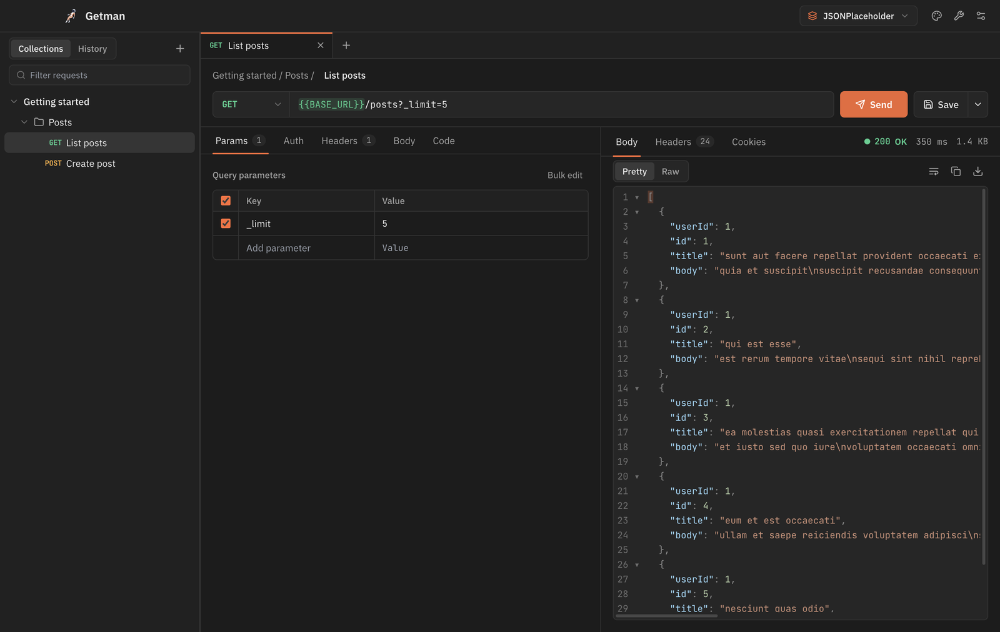
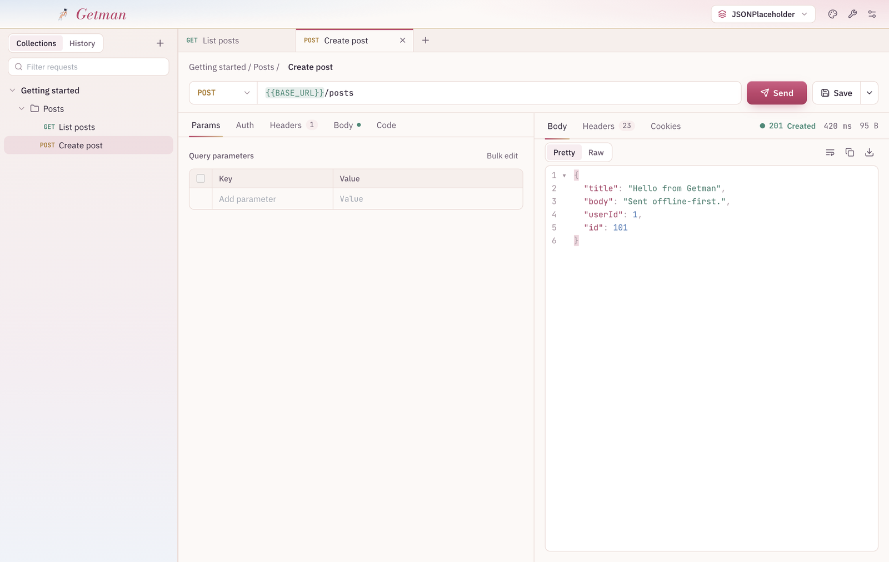

<div align="center">


# Getman

**A fast, offline API client for your desktop.**<br />
No account, no cloud, no telemetry. Your requests stay on your computer.

[**Download for macOS**](#download) · [**Windows**](#download) · [**Linux**](#download)

<br />



</div>

<br />

## Download

| Your computer | Download |
| --- | --- |
| Mac with Apple chip (M1, M2, M3, M4) | [Getman-mac-arm64.dmg](https://github.com/digisamu/Getman-Postman-Clone/releases/latest/download/Getman-mac-arm64.dmg) |
| Mac with Intel chip | [Getman-mac-x64.dmg](https://github.com/digisamu/Getman-Postman-Clone/releases/latest/download/Getman-mac-x64.dmg) |
| Windows 10 or 11 | [Getman-windows-setup.exe](https://github.com/digisamu/Getman-Postman-Clone/releases/latest/download/Getman-windows-setup.exe) |
| Linux (any distro) | [Getman-linux.AppImage](https://github.com/digisamu/Getman-Postman-Clone/releases/latest/download/Getman-linux.AppImage) |
| Linux (Debian, Ubuntu) | [Getman-linux.deb](https://github.com/digisamu/Getman-Postman-Clone/releases/latest/download/Getman-linux.deb) |

Not sure which Mac you have? Open the Apple menu → **About This Mac** and look at **Chip**.

All files are also on the [Releases page](https://github.com/digisamu/Getman-Postman-Clone/releases/latest).

### First launch

Getman isn't signed with a paid Apple or Microsoft certificate yet, so your computer asks once before opening it.

- **Mac:** open the `.dmg`, drag **Getman** into **Applications**, and open it. If macOS says it can't check the app, open **System Settings → Privacy & Security**, scroll down, and click **Open Anyway**.
- **Windows:** if a blue "Windows protected your PC" box appears, click **More info → Run anyway**.
- **Linux:** right-click the `.AppImage` → **Properties → Allow executing as program**, then double-click it.

<br />

## What it does

**Send requests.** Every HTTP method, with query params, headers, Bearer or Basic auth, and JSON, text, form-data or URL-encoded bodies. Paste a cURL command into the URL bar and it turns into a request.

**Read responses.** Status, time and size at a glance. Pretty-printed JSON with folding and search, HTML and image previews, headers, cookies, and one click to copy or save.

**Stay organised.** Tabs for open requests, collections with folders, history grouped by day, and environments with `{{variables}}` that light up green when they're set and red when they're missing.

**Move your work.** Import and export Postman v2.1 collections. Copy any request as cURL, JavaScript, Python or Java.

**Handy tools.** JWT decoder, Base64, JSON formatter, UUID generator and timestamp converter, all offline.

**Four themes.** Postman, Dark, Light, and Sydney:

<div align="center">

</div>

<br />

## Keyboard shortcuts

| Action | Mac | Windows / Linux |
| --- | --- | --- |
| Send request | <kbd>⌘</kbd> <kbd>Enter</kbd> | <kbd>Ctrl</kbd> <kbd>Enter</kbd> |
| Cancel request | <kbd>Esc</kbd> | <kbd>Esc</kbd> |
| New tab | <kbd>⌘</kbd> <kbd>T</kbd> | <kbd>Ctrl</kbd> <kbd>T</kbd> |
| Close tab | <kbd>⌘</kbd> <kbd>W</kbd> | <kbd>Ctrl</kbd> <kbd>W</kbd> |
| Switch tab | <kbd>Ctrl</kbd> <kbd>Tab</kbd> | <kbd>Ctrl</kbd> <kbd>Tab</kbd> |
| Save | <kbd>⌘</kbd> <kbd>S</kbd> | <kbd>Ctrl</kbd> <kbd>S</kbd> |
| Import collection | <kbd>⌘</kbd> <kbd>O</kbd> | <kbd>Ctrl</kbd> <kbd>O</kbd> |
| Settings | <kbd>⌘</kbd> <kbd>,</kbd> | <kbd>Ctrl</kbd> <kbd>,</kbd> |

<br />

## Your data

Everything is saved in one file on your computer:

- **Mac:** `~/Library/Application Support/Getman/workspace.json`
- **Windows:** `%APPDATA%\Getman\workspace.json`
- **Linux:** `~/.config/Getman/workspace.json`

Coming from Getman 0.1? Your collections, environments and history are imported automatically on first launch.

<br />

## For developers

You need [Node.js](https://nodejs.org) 20 or newer.

```bash
npm install
npm run dev
```

| Command | What it does |
| --- | --- |
| `npm run dev` | Runs the app with live reload |
| `npm run dev:web` | Runs the UI in a browser at http://localhost:1420 |
| `npm test` | Runs the unit tests |
| `npm run build` | Type-checks and builds |
| `npm run dist:mac` / `dist:win` / `dist:linux` | Builds installers into `release/` |

**Publishing a new version:** change `version` in `package.json`, commit, then push a tag. GitHub builds the installers for all three systems and publishes them on the Releases page.

```bash
git tag v0.2.1
git push origin v0.2.1
```

Built with Electron, React, TypeScript, Vite, Tailwind CSS, Zustand and CodeMirror.

More detail: [User guide](docs/USER_GUIDE.md) · [Architecture](docs/ARCHITECTURE.md) · [Troubleshooting](docs/TROUBLESHOOTING.md)
